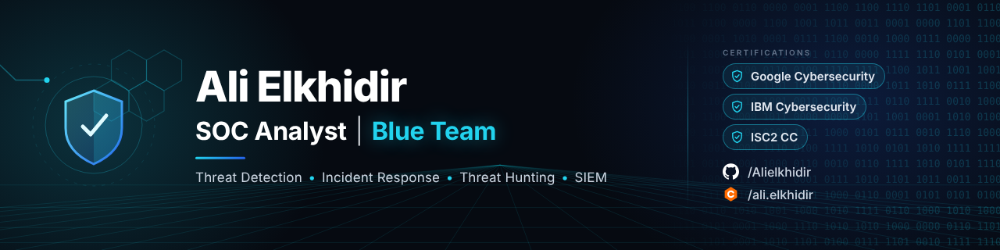

  

  
  
  
  

## About

Junior SOC analyst focused on threat detection, log analysis, and incident response. I'm ISC2 CC certified and hold the Google Cybersecurity and IBM Cybersecurity Analyst professional certificates.

Before cybersecurity, I built and ran my own trading business, which taught me to work independently and stay accountable without supervision.

I publish my labs here to show how I think and learn. I'm open to entry-level SOC and security analyst roles, remote included.

## Featured Project: SOC Labs

A growing collection of hands-on labs, investigation notes, incident reports, and detection rule templates. I add to it every time I finish a new lab.

<!--
Optional: delete the opening and closing comment lines to show your latest labs here,
after replacing the example row with a real lab.

### Latest Labs

| Lab | Tools | What I practiced |
|---|---|---|
| [Lab title](https://github.com/Alielkhidir/SOC-Labs/tree/main/FOLDER) | Splunk | One-line summary |
-->

## Certifications

| Certification | Issuer | Date | Verify |
|---|---|---|---|
| Certified in Cybersecurity (CC) | ISC2 | Jul 2026 (valid to Jul 2029) | [Credly](https://www.credly.com/badges/8fa77006-d6c1-4967-9960-9d7dafa370df/linked_in_profile) |
| Google Cybersecurity Professional Certificate V2 | Google / Coursera | Jul 2025 | [Credly](https://www.credly.com/badges/902c5248-6e00-4e55-8259-40b607292620/linked_in_profile) |
| IBM Cybersecurity Analyst Professional Certificate V2 | IBM / Coursera | Nov 2025 | [Coursera](https://www.coursera.org/account/accomplishments/specialization/IK6E8D5ZS9EY) |
| CompTIA Security+ | CompTIA | In progress | |

13 IBM skills badges and 27 ACE-recommended college credit hours

 

**Security operations:** Incident Response and Digital Forensics · Penetration Testing, Threat Hunting, and Cryptography · Cybersecurity Breach Case Studies · Generative AI Essentials for Cybersecurity

**Foundations:** Cybersecurity Essentials · Introduction to Cybersecurity Tools and Cyberattacks · Introduction to Cybersecurity Careers · Operating Systems: Overview, Administration, and Security · Network Security & Database Vulnerabilities · Database Essentials and Vulnerabilities

**Architecture and governance:** Cybersecurity Architecture · Cybersecurity Compliance Framework, Standards & Regulations · CompTIA Security+ and CySA+ Exam Readiness

**ACE-recommended college credit:** 27 semester hours across the Google (9), IBM (15), and ISC2 CC (3) credentials. All verifiable on [Credly](https://www.credly.com/users/ali.elkhidir).

## Skills

| Area | Tools and topics |
|---|---|
| Detection & analysis | Splunk, Microsoft Sentinel, Windows Event Logs, log analysis, alert triage |
| Network | Wireshark, Nmap, TCP/IP, DNS, DHCP |
| Systems | Linux, Kali Linux, Windows |
| Security testing | Burp Suite, TryHackMe, CTFs |
| Scripting & tools | Python (basic), Bash, Git, GitHub, VS Code |

**Currently learning:** CompTIA Security+, Splunk, Microsoft Sentinel
