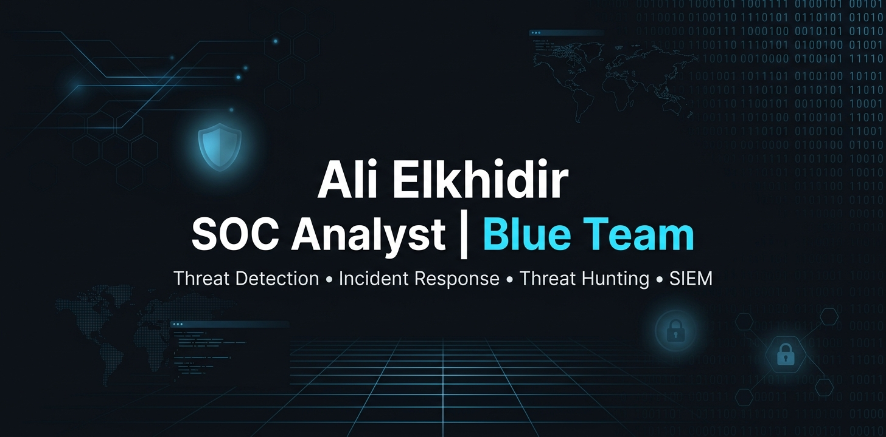

  

# Hi, I'm Ali 👋

## 👋 About Me

Aspiring SOC Analyst building hands-on Blue Team skills in log analysis, detection, and incident response. ISC2 CC certified, preparing for Security+. I publish my labs here to show how I think and learn. Looking for an entry-level SOC or security analyst role.

## 🎯 Currently Learning

- CompTIA Security+
- Splunk
- Microsoft Sentinel

## 🛠️ Tech Stack

## 🚀 Featured Project

### 🛡️ SOC Labs

A collection of hands-on cybersecurity labs, investigation notes, incident reports, and detection rule templates documenting my journey toward becoming a Security Operations Center (SOC) Analyst.

**Repository:**  
<a/> 
## 📜 Certifications

- ✅ ISC2 Certified in Cybersecurity (CC)
- ✅ Google Cybersecurity Professional Certificate
- ✅ IBM Cybersecurity Analyst
- ⏳ CompTIA Security+ (In Progress)

## 📫 Let's Connect

  
  
  
  

